  

  

  
  
  
  

---

## 👋 About me

I'm a software engineering student from Sri Lanka who likes building AI-powered tools, full-stack web apps and research projects.

| | |
|---|---|
| 🎓 **Education** | 3rd-year Software Engineering / BSc IT, **Rajarata University of Sri Lanka** (Faculty of Applied Sciences) |
| 🎤 **Leadership** | President of the **Fastunes Music Society**, RUSL |
| 🔬 **Research** | Deep-learning chord recognition and lead-sheet generation for Sinhala popular songs |
| 🎸 **Music** | Rhythm guitar, performances with Fastunes, and Sinhala chord songbooks |
| 💻 **Focus** | Full-stack web development, AI/ML, and developer tools |
| 📍 **Location** | Kuliyapitiya, Sri Lanka |

---

## 🛠️ Tech stack

  

---

## 🚀 Featured projects

<table>
  <tr>
    <td width="50%" valign="top">
      <h3>🎸 <a href="https://github.com/LapaluLiyanage/Chordarium">Chordarium</a></h3>
      
Chord detection web app for <b>Sinhala and English</b> songs, and the focus of my research. Analyzes audio from YouTube and builds a chord timeline and lead sheet.

      <code>Python</code> · <code>Flask</code> · <code>React</code> · <code>Deep Learning</code>
    </td>
    <td width="50%" valign="top">
      <h3>🎛️ Chordarium Studio in progress</h3>
      
A planned Cubase plugin that turns a pasted chord sheet and a short brief into a multi-track MIDI arrangement.

      <code>VST3</code> · <code>MCP</code> · <code>AI</code>
    </td>
  </tr>
  <tr>
    <td valign="top">
      <h3>🐜 <a href="https://github.com/LapaluLiyanage/ENHANCED_ANT_COLONY_ALGORITHM">Enhanced Ant Colony Algorithm</a></h3>
      
Ant-colony heuristic that uses the geometric mean to solve multi-objective transportation problems. Includes a <a href="https://enhancedantcolonyalgorithm.streamlit.app/">live Streamlit demo</a>.

      <code>Python</code> · <code>Streamlit</code> · <code>Optimization</code>
    </td>
    <td valign="top">
      <h3>🖼️ <a href="https://github.com/LapaluLiyanage/Full-Frame">Full Frame</a></h3>
      
Published Chrome extension for downloading Facebook albums in full quality, with 200+ users and a 5.0 rating on the Chrome Web Store.

      <code>JavaScript</code> · <code>Chrome Extension</code>
    </td>
  </tr>
  <tr>
    <td valign="top">
      <h3>🎬 <a href="https://github.com/LapaluLiyanage/clipforge">ClipForge</a></h3>
      
Video download tool that I'm extending with more platforms, including Facebook video support.

      <code>Python</code> · <code>CLI</code>
    </td>
    <td valign="top">
      <h3>🅿️ AI-Enhanced Smart Parking System</h3>
      
Parking management system with AI features powered by the Google Gemini API.

      <code>Spring Boot</code> · <code>Gemini API</code> · <code>MySQL</code>
    </td>
  </tr>
  <tr>
    <td valign="top">
      <h3>💊 MediBloom</h3>
      
Android medication-management app built with MVVM architecture and Room.

      <code>Java</code> · <code>Android</code> · <code>Room</code>
    </td>
    <td valign="top">
      <h3>📚 LearnSync</h3>
      
Flask-based learning management system for courses, learners and content.

      <code>Python</code> · <code>Flask</code>
    </td>
  </tr>
</table>

> More projects, write-ups and live demos on **[lapalu.me](https://lapalu.me)**

---

## 🎤 Leadership

As **President of the Fastunes Music Society** at RUSL, I lead the committee and organize society events and recruitment.

- 🗓️ Ran the **[Fastunes Online Auditions 2026](https://fastunes-audition.vercel.app/)** recruitment drive for the new batch
- 🌐 Building the society's multi-page website

---

## 🎶 Music

Music is the other side of my work, and it's why I'm building chord-recognition tools.

- 🎸 Play rhythm guitar (open chords and barre chords)
- 🎤 Perform with **Fastunes**, the RUSL music society founded in 2016
- 🎙️ Pioneered the **Open Mic** concept at Rajarata University (Vol 1.0 – 3.0)
- 📺 Performed on national television on Swarnavahini's **PM Show**
- 🎪 Performed at the **FASEXPLORE** exhibition closing ceremony
- 📒 Create and organize Sinhala chord songbooks, which led to my **Chordarium** research

---

## 📈 Currently

- 🔭 Building **Chordarium** and planning **Chordarium Studio**
- 📖 Working through the **Deep Learning Specialization** on Coursera
- 🌱 Learning more Spring Boot, REST API design and system design
- 🤝 Looking for internship opportunities in software engineering

---

## 📊 GitHub

  
  
  

  

---

## 📫 Let's connect

I'm always happy to talk about software, AI and research.

  
  
  

