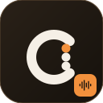
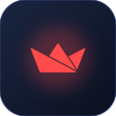
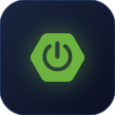
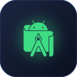

  

  

  
  
  
  

I'm a software engineering student from Sri Lanka who likes building AI-powered tools, full-stack web apps and research projects.

<table>
  <tr>
    <td width="36"></td>
    <td width="120"><b>Education</b></td>
    <td>3rd-year Software Engineering / BSc IT, <b>Rajarata University of Sri Lanka</b> (Faculty of Applied Sciences)</td>
  </tr>
  <tr>
    <td></td>
    <td><b>Leadership</b></td>
    <td>President of the <b>Fastunes Music Society</b>, RUSL</td>
  </tr>
  <tr>
    <td></td>
    <td><b>Research</b></td>
    <td>Deep-learning chord recognition and lead-sheet generation for Sinhala popular songs</td>
  </tr>
  <tr>
    <td></td>
    <td><b>Music</b></td>
    <td>Rhythm guitar, performances with Fastunes, and Sinhala chord songbooks</td>
  </tr>
  <tr>
    <td></td>
    <td><b>Focus</b></td>
    <td>Full-stack web development, AI/ML, and developer tools</td>
  </tr>
  <tr>
    <td></td>
    <td><b>Location</b></td>
    <td>Kuliyapitiya, Sri Lanka</td>
  </tr>
</table>

  

<table>
  <tr>
    <td width="72" valign="top"></td>
    <td width="38%" valign="top">
      <b><a href="https://github.com/LapaluLiyanage/Chordarium">Chordarium</a></b> 
      Chord detection web app for <b>Sinhala and English</b> songs, and the focus of my research. Analyzes audio from YouTube and builds a chord timeline and lead sheet. 
      <code>Python</code> · <code>Flask</code> · <code>React</code> · <code>Deep Learning</code>
    </td>
    <td width="72" valign="top"></td>
    <td width="38%" valign="top">
      <b>Chordarium Studio</b> in progress 
      A planned Cubase plugin that turns a pasted chord sheet and a short brief into a multi-track MIDI arrangement. 
      <code>VST3</code> · <code>MCP</code> · <code>AI</code>
    </td>
  </tr>
  <tr>
    <td valign="top"></td>
    <td valign="top">
      <b><a href="https://github.com/LapaluLiyanage/ENHANCED_ANT_COLONY_ALGORITHM">Enhanced Ant Colony Algorithm</a></b> 
      Ant-colony heuristic that uses the geometric mean to solve multi-objective transportation problems. Includes a <a href="https://enhancedantcolonyalgorithm.streamlit.app/">live Streamlit demo</a>. 
      <code>Python</code> · <code>Streamlit</code> · <code>Optimization</code>
    </td>
    <td valign="top"></td>
    <td valign="top">
      <b><a href="https://github.com/LapaluLiyanage/Full-Frame">Full Frame</a></b> 
      Published Chrome extension for downloading Facebook albums in full quality, with 200+ users and a 5.0 rating on the Chrome Web Store. 
      <code>JavaScript</code> · <code>Chrome Extension</code>
    </td>
  </tr>
  <tr>
    <td valign="top"></td>
    <td valign="top">
      <b><a href="https://github.com/LapaluLiyanage/clipforge">ClipForge</a></b> 
      Video download tool that I'm extending with more platforms, including Facebook video support. 
      <code>Python</code> · <code>Browser Extension</code>
    </td>
    <td valign="top"></td>
    <td valign="top">
      <b>AI-Enhanced Smart Parking System</b> 
      Parking management system with AI features powered by the Google Gemini API. 
      <code>Spring Boot</code> · <code>Gemini API</code> · <code>MySQL</code>
    </td>
  </tr>
  <tr>
    <td valign="top"></td>
    <td valign="top">
      <b>MediBloom</b> 
      Android medication-management app built with MVVM architecture and Room. 
      <code>Java</code> · <code>Android</code> · <code>Room</code>
    </td>
    <td valign="top"></td>
    <td valign="top">
      <b>LearnSync</b> 
      Flask-based learning management system for courses, learners and content. 
      <code>Python</code> · <code>Flask</code>
    </td>
  </tr>
</table>

> More projects, write-ups and live demos on **[lapalu.me](https://lapalu.me)**

As **President of the Fastunes Music Society** at RUSL, I lead the committee and organize society events and recruitment.

<table>
  <tr>
    <td width="36"></td>
    <td>Ran the <b><a href="https://fastunes-audition.vercel.app/">Fastunes Online Auditions 2026</a></b> recruitment drive for the new batch</td>
  </tr>
  <tr>
    <td></td>
    <td>Building the society's multi-page website</td>
  </tr>
</table>

Music is the other side of my work, and it's why I'm building chord-recognition tools.

<table>
  <tr>
    <td width="36"></td>
    <td>Play rhythm guitar (open chords and barre chords)</td>
  </tr>
  <tr>
    <td></td>
    <td>Perform with <b>Fastunes</b>, the RUSL music society founded in 2016</td>
  </tr>
  <tr>
    <td></td>
    <td>Pioneered the <b>Open Mic</b> concept at Rajarata University (Vol 1.0 – 3.0)</td>
  </tr>
  <tr>
    <td></td>
    <td>Performed on national television on Swarnavahini's <b>PM Show</b></td>
  </tr>
  <tr>
    <td></td>
    <td>Performed at the <b>FASEXPLORE</b> exhibition closing ceremony</td>
  </tr>
  <tr>
    <td></td>
    <td>Create and organize Sinhala chord songbooks, which led to my <b>Chordarium</b> research</td>
  </tr>
</table>

<table>
  <tr>
    <td width="36"></td>
    <td>Building <b>Chordarium</b> and planning <b>Chordarium Studio</b></td>
  </tr>
  <tr>
    <td></td>
    <td>Working through the <b>Deep Learning Specialization</b> on Coursera</td>
  </tr>
  <tr>
    <td></td>
    <td>Learning more Spring Boot, REST API design and system design</td>
  </tr>
  <tr>
    <td></td>
    <td>Looking for internship opportunities in software engineering</td>
  </tr>
</table>

  
  
  

  

I'm always happy to talk about software, AI and research.

  
  
  

